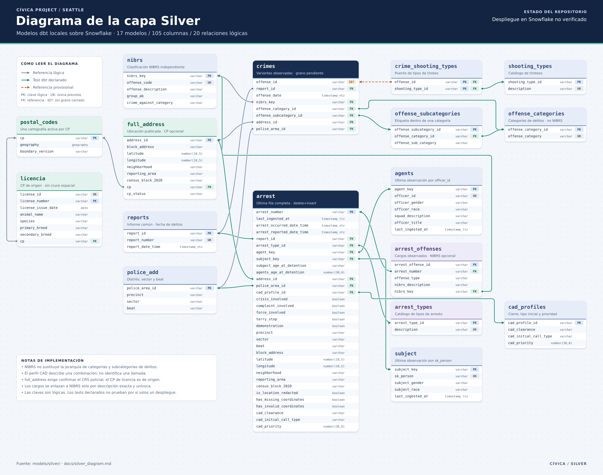

# Civica Project

Cívica prepara datos abiertos de Seattle con dbt y Snowflake: delitos, detenciones, licencias de mascotas y cartografía postal. El código postal (CP) permite comparar estos conjuntos por zona. **La relación es geográfica:** compartir CP no vincula una mascota, una persona o una licencia con un hecho policial.

## Capas y alcance

| Capa | Dónde | Qué hace |
| --- | --- | --- |
| Bronze | `DBT_BRONZE.RAW` | Declara `CRIMES`, `ARRESTS`, `PET_LICENSES` y `ZIPCODE_AREAS`. La carga es externa a dbt. |
| Staging | `DBT_BRONZE.STG` | Cuatro vistas que renombran, tipan y normalizan sin deduplicar ni eliminar asociaciones. |
| Silver | `DBT_SILVER.SILVER` | 17 modelos: fijan los granos, seleccionan versiones, conservan asociaciones y calculan el CP policial. |
| Gold | `DBT_GOLD.GOLD` | Publica las dimensiones y los dos puentes como vistas de Snowflake; los hechos siguen siendo incrementales. |
| Marts | `DBT_GOLD.MARTS` | Tres tablas anuales por CP para comparar delitos y licencias de mascotas y una tabla por delito para el [mapa por calle](docs/marts.md#mapa-de-delitos-por-calle). |

## Silver: diseño definitivo

La [memoria de Silver](docs/silver.md) explica los 17 modelos, los datos que motivaron las decisiones y cómo ejecutar y validar la capa en DEV. Las decisiones principales son:

- Una fila por pareja informe–delito, por número de detención y por número de licencia. Las etiquetas de tiroteo y los cargos se conservan aparte para no inflar los recuentos. Un informe compartido no empareja delitos con detenciones.
- Solo `crimes`, `arrest` y `licenses` son incrementales: reemplazan la fila completa mediante `delete+insert` y solo admiten ingestas posteriores al máximo de su propia tabla. Los otros 14 modelos se reconstruyen.
- El CP policial se asigna solo si el punto está en el interior de una única zona. `full_address.cp_status` explica por qué puede quedar nulo. Las licencias toman el CP de origen si tiene cinco dígitos.

El [SVG definitivo](docs/silver_diagram.svg) y el [diccionario con DBML editable](docs/silver_diagram.md) muestran el mismo esquema: 17 modelos y 19 relaciones lógicas.

## Gold

La [guía de Gold](docs/gold.md) documenta las tablas, sus claves y cómo construir la capa. El [diagrama Gold en DBML](gold_diagram.dbml) se puede importar en dbdiagram.io.

## Casos de uso

El primer mart cuenta robos de vehículos (NIBRS `240`); el segundo reúne atracos, carterismos, tirones de bolso y otros hurtos (`120`, `23A`, `23B`, `23H`). El tercero cuenta todos los homicidios (`09A`, `09B`, `09C`) y cualquier otro delito con etiqueta de tiroteo. Los tres conservan las zonas con cero casos registrados. La [guía de los marts](docs/marts.md) detalla los criterios y la ejecución pendiente en DEV.

Para abrir el [panel de Seattle](visualizacion/README.md), ejecuta `./abrir-panel.sh` desde la raíz. El lanzador usa el Python de `.venv` en lugar del Python del sistema.

## Desarrollo y validación

Los [tests unitarios de Staging](tests/unit/_stg_unit_tests.yml) verifican que delitos y detenciones usen el mismo número de informe sin perder ceros (`20260000000001` → `2026-000001`), para que Silver no los trate como informes distintos.

Configurar `DBT_BRONZE` y `DBT_SILVER` para DEV (`DEV_BRONZE` y `DEV_SILVER` en el entorno documentado). `--target` no modifica esas variables. En dbt Core, usar el perfil `default` externo; en Studio, usar las variables del entorno. Consultar la [ejecución de Silver en DEV](docs/silver.md#ejecución-en-dev) para el comando, los permisos y la cartografía necesarios.

**El diseño está cerrado, pero no consta un `dbt build` integral de la versión actual con datos reales en Snowflake DEV.** La [regresión sintética](tests/integration/arrest_delete_insert_check.py) usa un esquema DEV aislado. Si existe un Silver anterior, comprobar el histórico de RAW y coordinar la migración y el respaldo antes de usar `--full-refresh`: `on_schema_change='fail'` no migra columnas ni claves.

La ingesta es externa a dbt. Sus scripts no están versionados en Git y no se presupone que su programación ni la task de Snowflake estén activas. Véase el [contexto de ingesta](contexto.md#ingesta-y-datos-locales). `Datos_ejemplo/` está ignorada por Git y no se usa como fuente dbt.
