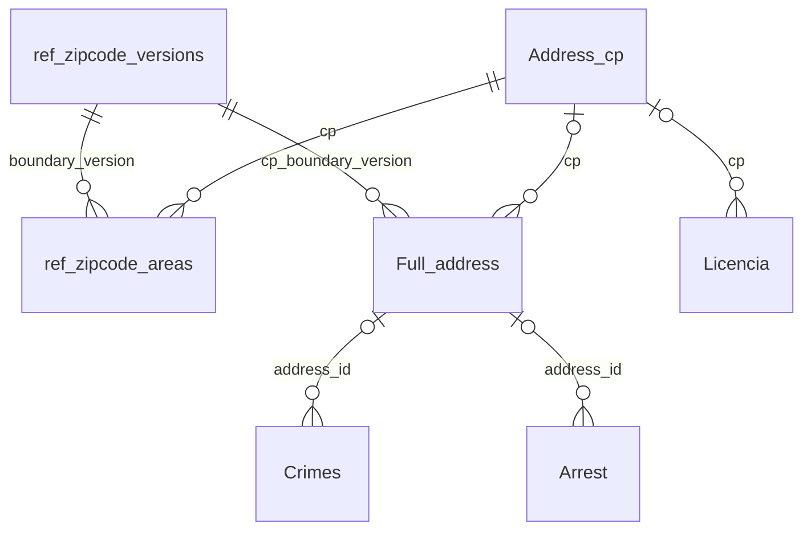

# Histórico: propuesta de código postal para delitos y arrestos

## Alcance y archivos

Esta página conserva la propuesta inicial y las comprobaciones que la motivaron. Las tablas, pasos y SQL siguientes no son el diseño vigente. Consultar la [implementación postal de Silver](silver.md#áreas-cartografía-y-código-postal) y el [diccionario y diagrama definitivos](silver_diagram.md).

La solución calcula el CP de la zona que contiene las coordenadas publicadas. No reconstruye una dirección exacta ni verifica un domicilio con USPS. Las licencias mantienen el CP que proporciona su propia fuente.

## Qué cambia en el diagrama

Se conservan las 15 tablas originales y sus relaciones. Se añaden dos tablas:

- `ref_zipcode_versions`: identifica cada descarga cartográfica, su procedencia, fecha, sistema de referencia y huella SHA-256.
- `ref_zipcode_areas`: guarda los polígonos de cada versión. Una misma zona postal puede estar representada por varias entidades de origen.

`Full_address` incorpora `cp_status`, `cp_boundary_version`, `cp_checked_at` y `cp_match_count`. Su `cp` sigue siendo opcional. Latitud y longitud pasan de `decimal(12,8)` a `decimal(18,12)` para conservar la precisión que ya ofrece staging.

La tabla de versiones permite explicar qué mapa se utilizó incluso cuando una ubicación no tiene coordenadas y no se intenta el cruce. No implica guardar todas las versiones del resultado de cada dirección: `Full_address` conserva una evaluación actual; un histórico de asignaciones sería una ampliación posterior.



Las líneas anteriores son FK. El cruce espacial es una transformación adicional: no existe una FK que signifique «este punto está dentro de este polígono».

## Comprobación preliminar con los CSV

Se analizaron los archivos de `Datos_ejemplo/` mediante un cruce espacial local con la capa pública de King County. Los límites se exportaron a EPSG:4326; la comprobación exploratoria utilizó contención planar de puntos en los polígonos, no una ejecución en Snowflake. Se descartaron puntos ocultados, marcadores `-1` y coordenadas fuera de un filtro regional preliminar (`47 ≤ latitud ≤ 49`, `-124 ≤ longitud ≤ -120`). Este rectángulo no es un límite municipal ni una regla de producción definitiva.

| Resultado | Crimes | Arrests |
| --- | ---: | ---: |
| Filas del CSV | 1.575.312 | 145.625 |
| Una única zona postal encontrada | 1.172.257 | 143.206 |
| Cobertura sobre todas las filas | 74,41 % | 98,34 % |
| Coordenadas ausentes, marcador `-1` | 173.136 | 2.401 |
| Ubicación ocultada | 229.382 | 0 |
| Coordenadas sospechosas fuera del filtro regional | 537 | 18 |

Son filas, no delitos o arrestos únicos. Se encontraron 136.314 pares de coordenadas distintos que pasaron el filtro entre ambos archivos. Cada uno coincidió con un único CP en esta prueba. La descarga utilizada contenía 273 entidades geográficas y 251 CP distintos, incluidos tipos `Standard`, `PO Box` y `Unique`.

Estos resultados validan la viabilidad del enfoque, no la precisión postal real de cada registro. La prueba no cuantificó la incertidumbre cerca de los límites. La ejecución final con `GEOGRAPHY` de Snowflake y las reglas conservadoras de límites puede producir cifras diferentes.

Ejemplos obtenidos a partir de puntos publicados en los CSV:

| Dirección publicada | CP de la zona |
| --- | --- |
| `MARION ST / 4TH AVE` | `98104` |
| `14XX BLOCK OF NE RAVENNA BLVD` | `98105` |
| `130XX BLOCK OF LAKE CITY WAY NE` | `98125` |
| `17XX BLOCK OF SUMMIT AVE` | `98122` |

## Paso 1. Descargar y conservar los límites postales

Fuente: [Zipcodes for King County and Surrounding Area](https://www5.kingcounty.gov/sdc/?Layer=zipcode_area), publicada por King County GIS Center.

Servicio consultado:

```text
https://services.arcgis.com/Ej0PsM5Aw677QF1W/arcgis/rest/services/ZIPCODE_AREA_113/FeatureServer/0
```

Exportar la colección completa a GeoJSON, solicitando los campos `OBJECTID`, `ZIPCODE` y `ZIP_TYPE` y los polígonos. La consulta debe incluir `outSR=4326`: el sistema nativo de la capa es EPSG:2926 y no debe confundirse con longitud/latitud.

Al descargar:

1. Consultar el número total de entidades.
2. Paginar si el servicio limita el número de resultados y comprobar `exceededTransferLimit`.
3. Verificar que el archivo contiene tantas entidades como declara la fuente.
4. Conservar el GeoJSON exacto, los parámetros de exportación y los metadatos disponibles en almacenamiento de entrada, fuera de la tabla Silver.
5. Calcular su SHA-256. Asignar un identificador estable a la instantánea y no modificarla después.

No limitar la descarga a Seattle: los datos incluyen ubicaciones fuera de la ciudad. No sustituir los polígonos por centroides ni seleccionar el CP cuyo centro esté más cerca del punto.

## Paso 2. Cargar la referencia en Snowflake

La ingesta del GeoJSON corresponde a un proceso externo o de carga a un stage de Snowflake. dbt transformará después la fuente cargada; no hará peticiones HTTP por cada delito o arresto.

1. Leer las entidades del archivo de entrada.
2. Comprobar que `ZIPCODE` tiene cinco dígitos y conservarlo como texto.
3. Convertir únicamente el objeto GeoJSON `geometry` de cada entidad a `GEOGRAPHY`.
4. Comprobar que es un Polygon o MultiPolygon válido en EPSG:4326. Una conversión fallida debe generar una incidencia y bloquear la activación de la versión incompleta, no desaparecer silenciosamente del mapa.
5. Construir `zipcode_area_key` de forma determinista a partir de `boundary_version` y `source_area_id` (`OBJECTID`). La pareja también debe ser única.
6. Cargar `ref_zipcode_versions` y `ref_zipcode_areas`, y activar la versión solo después de validar el conjunto completo.

La fecha de actualización del servicio y la fecha de descarga no son fechas de vigencia histórica de los CP. Conservar ambas sin presentarlas como equivalentes.

## Paso 3. Construir el catálogo común Address_cp

Crear una lista sin duplicados con:

- Los CP con formato válido de `stg_pet_licenses.zip_code`.
- Los CP de todas las versiones cartográficas cargadas.

Así las licencias pueden conservar códigos que no tengan un polígono en la cobertura local, y las versiones anteriores mantienen sus referencias. La presencia en el catálogo solo acredita el formato y la procedencia, no una validación independiente contra USPS.

Registrar los códigos vacíos o de formato inválido como incidencias y dejar la referencia postal nula cuando corresponda. En los CSV aparecen códigos de cuatro dígitos: no anteponerles un cero por suposición. Tampoco eliminar los códigos de fuera de Seattle solo porque no sean útiles para un análisis municipal concreto.

## Paso 4. Preparar las ubicaciones policiales

Combinar los campos geográficos de `stg_crimes` y `stg_arrests` para construir las ubicaciones normalizadas. Conservar las coordenadas con la precisión de staging y confirmar en los metadatos del origen policial que representan longitud y latitud compatibles con EPSG:4326. Su rango y ubicación son compatibles en la prueba, pero eso no sustituye la confirmación documental.

Antes de deduplicar, conservar `is_location_redacted` como contexto de procesamiento. No inferir la ocultación solo a partir de los nulos, porque staging ya ha normalizado algunos marcadores.

La identidad de una ubicación no se debe basar únicamente en `block_address` ni en el CP calculado. Debe considerar sus coordenadas y el contexto publicado necesario para no mezclar ubicaciones distintas. En particular, no convertir todos los registros con campos vacíos en una supuesta dirección real compartida. La regla general de identidad e historización de direcciones deberá concretarse al implementar ese modelo.

Se puede calcular el cruce una sola vez por par de coordenadas elegible y reutilizar el resultado, sin fusionar por ello las distintas observaciones o contextos de origen. Un registro ocultado nunca debe heredar un CP por compartir valores con otra observación.

## Paso 5. Clasificar las ubicaciones antes del cruce

Aplicar este orden:

| Prioridad | Condición | `cp_status` | `cp_match_count` |
| --- | --- | --- | --- |
| 1 | La ubicación está marcada como ocultada. | `redacted` | Nulo |
| 2 | Falta alguna coordenada. | `missing_coordinates` | Nulo |
| 3 | Alguna coordenada no es numérica, finita o está fuera de su rango global; o incumple una regla de plausibilidad explícitamente aprobada. | `invalid_coordinates` | Nulo |
| 4 | Ambas coordenadas son utilizables. | Pendiente del cruce | Pendiente del cruce |

Los marcadores `-1` del origen ya se convierten en nulos en staging. Una latitud próxima a 90° puede ser válida globalmente, pero no plausible en estos datos: requiere una regla regional explícita o quedará sin coincidencia con la cobertura. No intentar «arreglar» el punto cambiando signos o intercambiando ejes sin evidencia.

Estar fuera del municipio de Seattle no invalida una ubicación. Estar fuera de la cobertura cartográfica puede producir `no_match`; no implica necesariamente un error de coordenadas.

## Paso 6. Cruzar puntos y zonas de una sola versión

Seleccionar una versión completa mediante configuración, por ejemplo la futura variable dbt `zipcode_boundary_version`. Utilizarla para todo el lote, incluidas las filas en las que no se intenta el cruce.

1. Disolver los polígonos por (`boundary_version`, `cp`) para eliminar fronteras internas entre piezas del mismo CP.
2. Construir cada punto con `ST_MAKEPOINT(longitude, latitude)`, en ese orden y solo después de validar las coordenadas.
3. Buscar zonas que cubran el punto con `ST_COVERS`.
4. Contar CP distintos y comprobar si el punto está en el interior con `ST_CONTAINS`.
5. Producir una sola evaluación por ubicación, conservando las que no coinciden con ninguna zona.

Reglas de resultado:

| Situación | `cp_status` | `cp` | `cp_match_count` |
| --- | --- | --- | --- |
| Ninguna zona cubre el punto. | `no_match` | Nulo | `0` |
| Más de un CP distinto cubre el punto. | `ambiguous` | Nulo | Mayor que `1` |
| Un único CP cubre el punto, pero el punto está exactamente en su límite. | `boundary` | Nulo | `1` |
| Un único CP contiene el punto en su interior. | `matched` | CP encontrado | `1` |

La comprobación exacta de límites no resuelve la incertidumbre de un bloque aproximado que esté cerca de una frontera postal. Esa limitación debe acompañar los análisis; una tolerancia adicional requeriría fijar y justificar una distancia.

Este SQL ilustra la parte espacial, no es un modelo dbt ya creado. Supone una entrada `eligible_locations` previamente validada y única por `address_id`, las tablas de referencia cargadas y la variable de sesión `$ZIPCODE_BOUNDARY_VERSION` definida:

```sql
with zones as (
    select
        boundary_version,
        cp,
        st_union_agg(geography) as zone
    from ref_zipcode_areas
    where boundary_version = $ZIPCODE_BOUNDARY_VERSION
    group by boundary_version, cp
),
points as (
    select
        address_id,
        st_makepoint(longitude, latitude) as point
    from eligible_locations
),
summary as (
    select
        p.address_id,
        count(distinct z.cp) as cp_match_count,
        min(z.cp) as candidate_cp,
        coalesce(count_if(st_contains(z.zone, p.point)), 0) as interior_count
    from points p
    left join zones z on st_covers(z.zone, p.point)
    group by p.address_id
)
select
    address_id,
    case
        when cp_match_count = 0 then 'no_match'
        when cp_match_count > 1 then 'ambiguous'
        when interior_count = 0 then 'boundary'
        else 'matched'
    end as cp_status,
    case
        when cp_match_count = 1 and interior_count > 0 then candidate_cp
        else null
    end as cp,
    cp_match_count
from summary;
```

`MIN(z.cp)` solo recoge el candidato; no se utiliza para elegir arbitrariamente entre varios CP. Una geometría inválida o una versión inexistente deben fallar antes de ejecutar esta consulta, no convertir todas las ubicaciones en `no_match`.

## Paso 7. Completar Full_address y conectar los hechos

Combinar las evaluaciones espaciales con los estados de filas omitidas en el paso 5. Cada ubicación debe tener una única fila final con:

- `cp`: informado únicamente con estado `matched`.
- `cp_status`: resultado de la evaluación, siempre informado.
- `cp_boundary_version`: versión seleccionada para el lote, siempre informada.
- `cp_checked_at`: instante de evaluación, siempre informado.
- `cp_match_count`: número de CP candidatos, o nulo si no se intentó el cruce.

Conservar todas las ubicaciones y registros policiales aunque su CP quede nulo. `Crimes` y `Arrest` mantienen sus FK a `Full_address`; no se les añade un CP duplicado.

No hacer depender `address_id` del resultado del enriquecimiento. Un cambio de cartografía puede cambiar el CP sin cambiar la identidad de la ubicación publicada.

## Paso 8. Añadir pruebas antes de activar la solución

En Snowflake, las PK, FK y restricciones de unicidad de las tablas estándar no garantizan por sí solas la calidad de los datos: deben comprobarse en dbt. Algunas reglas precisarán pruebas SQL específicas.

- Unicidad y no nulidad de las PK y de las parejas compuestas declaradas.
- Integridad de las 19 relaciones, respetando las FK opcionales.
- Geometrías completas, válidas y del tipo esperado; `export_srid = 4326`.
- Existencia de la versión configurada y coincidencia entre entidades descargadas y cargadas. No activar una descarga parcial.
- `cp_status` dentro de los siete valores definidos.
- `cp` no nulo si y solo si `cp_status = 'matched'`; en ese caso, `cp_match_count = 1`.
- `cp_match_count` nulo para filas omitidas, `0` para `no_match`, `1` para `boundary` y mayor que `1` para `ambiguous`.
- Ningún CP asignado a una ubicación ocultada o con coordenadas inutilizables.
- Una evaluación por ubicación y ningún aumento de filas de delitos o arrestos al incorporar el resultado postal.
- Pruebas con puntos interiores, límites, huecos de polígonos, piezas distintas del mismo CP, solapes entre CP, ubicaciones fuera de cobertura, nulos y coordenadas erróneas.
- Seguimiento de cobertura por fuente y periodo. No exigir un 100 % de CP: los datos ocultados o ausentes hacen imposible esa garantía.

## Paso 9. Actualizar la cartografía sin perder reproducibilidad

Descargar una nueva instantánea, cargarla con otro `boundary_version`, validarla y comparar sus asignaciones con las de la versión anterior antes de activarla. Conservar el archivo, los metadatos y los polígonos anteriores para poder repetir el cálculo.

La cartografía actual no acredita los límites postales vigentes en la fecha de un delito antiguo. Si el análisis exige esa precisión histórica, será necesario conseguir cartografía histórica con vigencias documentadas. La versión almacenada permite explicar el mapa utilizado, no sustituye esa información.

## Orden de trabajo previsto en dbt

Los siguientes son nombres propuestos, no archivos existentes ni modelos implementados:

```text
Ingesta externa del GeoJSON y sus metadatos
    ├── ref_zipcode_versions
    └── stg_zipcode_areas
              ├── Address_cp ← CP de stg_pet_licenses
              └── ref_zipcode_areas ← Address_cp + ref_zipcode_versions

stg_crimes + stg_arrests
    └── int_police_locations
              └── int_location_postal_assignment
                    ↑ ref_zipcode_areas + versión configurada
                          └── Full_address
                                ├── Crimes
                                └── Arrest

stg_pet_licenses + Address_cp
    └── Licencia
```

Construir `Address_cp` a partir de las entradas postales, no de `Full_address`, para evitar una dependencia circular. El catálogo es global entre versiones, pero cada evaluación espacial utiliza exactamente una versión.
